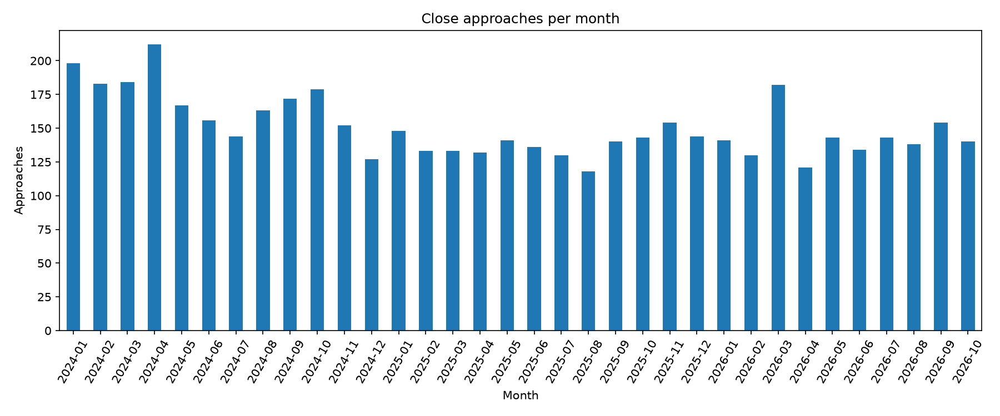
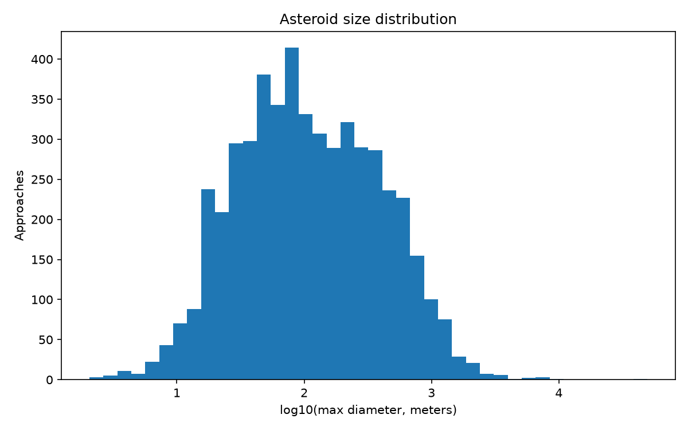
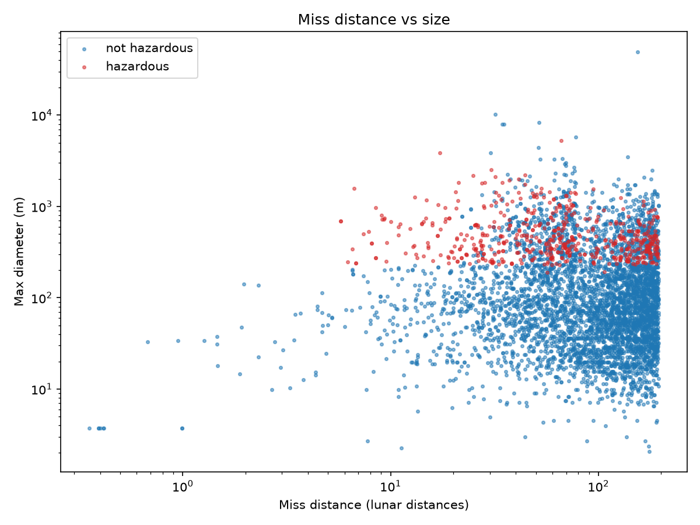

# Asteroid Tracker

Data pipeline and analysis of near-Earth asteroid close approaches using NASA's NeoWs API.

## What it does
- Downloads close-approach data from NASA NeoWs (Jan 2024 - Oct 2026) into a SQLite database
- Analyzes sizes, miss distances and "potentially hazardous" flags with pandas and Matplotlib

## Key numbers
- 5,115 close approaches, 3,830 unique asteroids (one asteroid can approach Earth several times)
- 477 unique asteroids flagged as potentially hazardous by NASA
- Median maximum diameter: about 99 m
- 10 approaches closer than the Moon
- The latest dates are NASA's predicted future approaches

## Plots

## Observations
- (write 2-3 findings from your plots here)

## How to run
1. Get a free API key at https://api.nasa.gov
2. Copy `.env.example` to `.env` and put your key there
3. `pip install -r requirements.txt`
4. `python src/fetch_feed.py` (downloads data into `data/asteroids.db`)
5. `python src/eda.py` (creates the plots)

## Next steps
- Machine learning: predict the hazardous flag from orbital elements only (a, e, i, q), using JPL SBDB data
- Streamlit dashboard of upcoming approaches